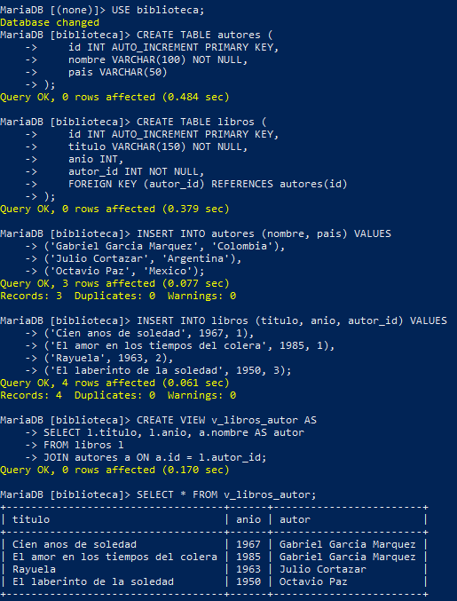
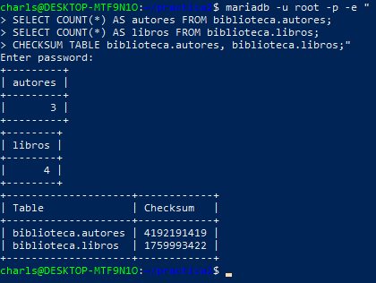
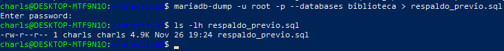
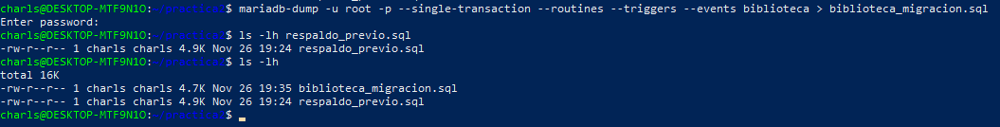
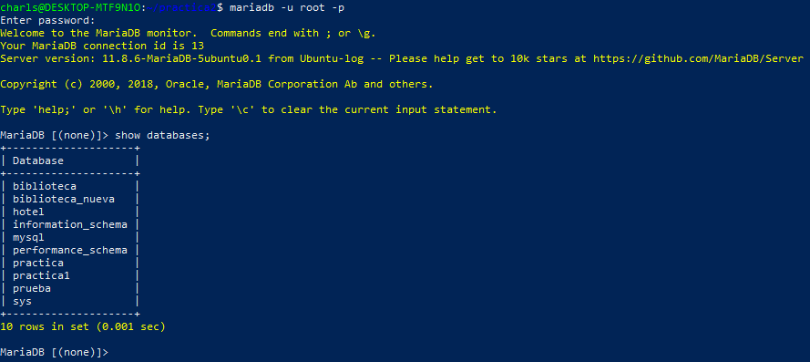
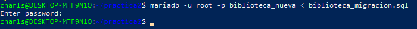
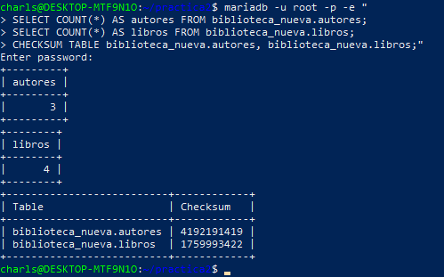
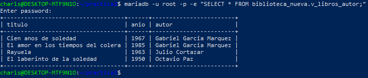
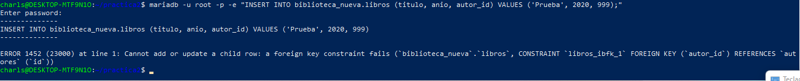
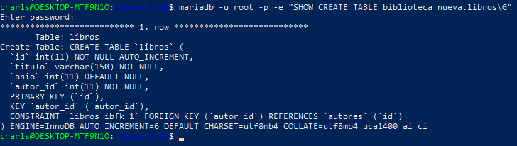

# Práctica 2: Migración de una base de datos en MariaDB

---

## **Instituto Tecnológico Nacional de México**  
### **Instituto Tecnológico de Milpa Alta 2**

* **Carrera:** Ingenieria en sistemas computacionales
* **Materia:** Administracion de bases de datos
* **Alumno:** Basurto García Carlos Yael
* **Número de Control:** 241190029
* **Docente:** Ing. Diego Alberto Bollas Paredes
* **Semestre:** Quinto
* **Fecha:** 26/11/26

---

## Introducción

La migración de bases de datos es un procedimiento fundamental dentro de la administración de sistemas de información, ya que permite trasladar la estructura, los registros y la lógica de negocio (vistas, procedimientos, disparadores y eventos) desde un entorno de origen hacia un nuevo destino manteniendo la integridad de los datos. Ya sea por actualización de hardware, cambio de versión del motor o reorganización de esquemas, ejecutar una migración controlada minimiza riesgos de pérdida de información y tiempo de inactividad.

En la presente práctica se lleva a cabo una migración homogénea dentro de **MariaDB** utilizando exclusivamente herramientas de línea de comandos (`mariadb` y `mariadb-dump`). El objetivo principal es trasladar la base de datos `biblioteca` hacia una nueva base denominada `biblioteca_nueva`, aplicando buenas prácticas como la generación de un respaldo preventivo y la posterior validación de integridad mediante conteos de registros, verificación de sumas de comprobación (`CHECKSUM TABLE`), pruebas de vistas y comprobación de restricciones de llave foránea.

---

## Preparación del entorno

Antes de iniciar con los pasos de la migración, se crea un directorio de trabajo dedicado para almacenar de forma ordenada los archivos de respaldo y exportación generados durante el proceso:

```bash
mkdir practica2 && cd practica2
```

---

## Desarrollo

### Paso 1. Creación de la base de datos de origen

En esta primera etapa se construye el entorno de origen que será migrado. Se inicia sesión en el cliente de MariaDB con privilegios de administrador y se ejecuta un conjunto de sentencias DDL (Lenguaje de Definición de Datos) y DML (Lenguaje de Manipulación de Datos) para crear la base de datos `biblioteca`, dos tablas relacionadas mediante una clave foránea (`autores` y `libros`), registros de prueba y una vista (`v_libros_autor`) que consolida la información de ambas tablas.

**Comandos ejecutados:**

```bash
mariadb -u root -p
```

```sql
CREATE DATABASE biblioteca;
USE biblioteca;

CREATE TABLE autores (
    id INT AUTO_INCREMENT PRIMARY KEY,
    nombre VARCHAR(100) NOT NULL,
    pais VARCHAR(50)
);

CREATE TABLE libros (
    id INT AUTO_INCREMENT PRIMARY KEY,
    titulo VARCHAR(150) NOT NULL,
    anio INT,
    autor_id INT NOT NULL,
    FOREIGN KEY (autor_id) REFERENCES autores(id)
);

INSERT INTO autores (nombre, pais) VALUES
('Gabriel Garcia Marquez', 'Colombia'),
('Julio Cortazar', 'Argentina'),
('Octavio Paz', 'Mexico');

INSERT INTO libros (titulo, anio, autor_id) VALUES
('Cien anos de soledad', 1967, 1),
('El amor en los tiempos del colera', 1985, 1),
('Rayuela', 1963, 2),
('El laberinto de la soledad', 1950, 3);

CREATE VIEW v_libros_autor AS
SELECT l.titulo, l.anio, a.nombre AS autor
FROM libros l
JOIN autores a ON a.id = l.autor_id;

SELECT * FROM v_libros_autor;
EXIT;
```

**Resultado obtenido:**
Se creó correctamente la base de datos `biblioteca` junto con sus tablas, registros y vista. Al consultar `v_libros_autor`, el motor devolvió los 4 libros asociados a su respectivo autor.



---

### Paso 2. Registro de los datos de origen (Línea base)

Previo a cualquier operación de traslado, es necesario documentar el estado exacto de los datos en el origen. Para ello se ejecutan consultas no interactivas desde la terminal (mediante la bandera `-e`) que contabilizan las filas de cada tabla y calculan su valor de `CHECKSUM TABLE`. Este valor actúa como una huella digital del contenido de la tabla y servirá como referencia para verificar la integridad tras la importación.

**Comando ejecutado:**

```bash
mariadb -u root -p -e "
SELECT COUNT(*) AS autores FROM biblioteca.autores;
SELECT COUNT(*) AS libros FROM biblioteca.libros;
CHECKSUM TABLE biblioteca.autores, biblioteca.libros;"
```

**Resultado obtenido:**
* Registros en `autores`: 3
* Registros en `libros`: 4
* Checksum `biblioteca.autores`: 4192191419
* Checksum `biblioteca.libros`: 1759993422



---

### Paso 3. Respaldo de seguridad previo a la migración

Como medida preventiva obligatoria en la administración de bases de datos, se genera un respaldo lógico completo de la base de datos de origen antes de iniciar el procedimiento de migración. Al utilizar la opción `--databases`, el archivo generado (`respaldo_previo.sql`) incluye explícitamente las sentencias `CREATE DATABASE` y `USE`, lo que permitiría restaurar el entorno original en caso de presentarse algún incidente. Posteriormente, se verifica la creación y el tamaño del archivo mediante `ls -lh`.

**Comandos ejecutados:**

```bash
mariadb-dump -u root -p --databases biblioteca > respaldo_previo.sql
ls -lh respaldo_previo.sql
```

**Resultado obtenido:**
Se generó el archivo `respaldo_previo.sql` de manera satisfactoria en la carpeta de trabajo, confirmando un tamaño válido mayor a cero bytes.



---

### Paso 4. Exportación de la base de datos para migración

Para trasladar el contenido hacia una base de datos con un nombre distinto (`biblioteca_nueva`), se ejecuta `mariadb-dump` **omitiendo** la opción `--databases`. De esta forma, el archivo resultante no fuerza la creación ni selección de la base `biblioteca`. Adicionalmente, se emplean las banderas `--single-transaction` (para asegurar una lectura consistente sin bloquear las tablas transaccionales InnoDB) y `--routines`, `--triggers` y `--events` para garantizar que toda la lógica almacenada sea incluida en el volcado.

**Comando ejecutado:**

```bash
mariadb-dump -u root -p --single-transaction --routines --triggers --events biblioteca > biblioteca_migracion.sql
```

**Resultado obtenido:**
Se generó el archivo `biblioteca_migracion.sql` sin errores en la terminal, conteniendo la estructura, los registros y la vista de la base de datos de origen.



---

### Paso 5. Creación de la base de datos de destino

Dado que el archivo de exportación generado en el paso anterior no contiene la instrucción de creación del esquema, es indispensable crear manualmente la base de datos vacía `biblioteca_nueva` que recibirá los objetos y registros migrados.

**Comando ejecutado:**

```bash
mariadb -u root -p -e "CREATE DATABASE biblioteca_nueva;"
```

**Resultado obtenido:**
La base de datos `biblioteca_nueva` fue creada correctamente en el servidor MariaDB.



---

### Paso 6. Importación en la base de datos de destino

En esta fase se realiza la carga de los datos hacia el nuevo esquema redirigiendo el contenido del archivo `biblioteca_migracion.sql` como entrada estándar (`<`) hacia el cliente de MariaDB, especificando `biblioteca_nueva` como base de datos objetivo.

**Comando ejecutado:**

```bash
mariadb -u root -p biblioteca_nueva < biblioteca_migracion.sql
```

**Resultado obtenido:**
El comando finalizó sin emitir mensajes de error, indicando que todas las sentencias SQL de creación de tablas, inserción de datos y definición de vistas fueron procesadas exitosamente.



---

### Paso 7. Validación de la migración

Una migración no puede considerarse concluida hasta comprobar de forma objetiva que el destino replica con exactitud la estructura, los datos y las reglas de negocio del origen. Para ello se ejecutan cuatro pruebas de verificación.

#### 7.1 Comparación de conteos y checksum

Se ejecutan las mismas consultas del Paso 2 sobre `biblioteca_nueva` para contrastar el número de filas y los valores de suma de comprobación.

**Comando ejecutado:**

```bash
mariadb -u root -p -e "
SELECT COUNT(*) AS autores FROM biblioteca_nueva.autores;
SELECT COUNT(*) AS libros FROM biblioteca_nueva.libros;
CHECKSUM TABLE biblioteca_nueva.autores, biblioteca_nueva.libros;"
```

**Resultado obtenido:**
Los conteos y los valores de `Checksum` coincidieron exactamente con los registrados en la base de datos de origen.



#### 7.2 Verificación funcional de la vista

Se consulta la vista `v_libros_autor` en el destino para comprobar que fue migrada correctamente y que sus referencias internas resuelven sobre las tablas de la nueva base de datos.

**Comando ejecutado:**

```bash
mariadb -u root -p -e "SELECT * FROM biblioteca_nueva.v_libros_autor;"
```

**Resultado obtenido:**
La vista devolvió los mismos 4 registros con el título del libro, año y nombre del autor correspondiente.



#### 7.3 Verificación de la integridad referencial

Para confirmar que las restricciones de llave foránea (`FOREIGN KEY`) permanecen activas, se intenta insertar deliberadamente un registro en la tabla `libros` haciendo referencia a un `autor_id` inexistente (`999`).

**Comando ejecutado:**

```bash
mariadb -u root -p -e "INSERT INTO biblioteca_nueva.libros (titulo, anio, autor_id) VALUES ('Prueba', 2020, 999);"
```

**Resultado obtenido:**
El motor rechazó la operación devolviendo un error de restricción de clave foránea (`ERROR 1452`), confirmando que la integridad referencial se conservó intacta tras la migración.



#### 7.4 Verificación de la estructura

Finalmente, se inspecciona la definición DDL de la tabla `libros` en el destino mediante `SHOW CREATE TABLE` con el modificador `\G` (formato vertical) para revisar tipos de datos, índices, codificación de caracteres y restricciones migradas.

**Comando ejecutado:**

```bash
mariadb -u root -p -e "SHOW CREATE TABLE biblioteca_nueva.libros\G"
```

**Resultado obtenido:**
Se visualizó la definición completa de la tabla `libros`, confirmando el motor `InnoDB`, las columnas, la llave primaria y la restricción `FOREIGN KEY` apuntando a `autores(id)`.



---

### Paso 8. Registro y comparación de resultados

En la siguiente tabla comparativa se resumen los resultados obtenidos entre la base de datos de origen (`biblioteca`) y la base de datos de destino (`biblioteca_nueva`):

| Comprobación | Origen (`biblioteca`) | Destino (`biblioteca_nueva`) | ¿Coincide? |
| :--- | :---: | :---: | :---: |
| Filas en `autores` | 3 | 3 | Sí |
| Filas en `libros` | 4 | 4 | Sí |
| Checksum `autores` | 4192191419 | 4192191419 | Sí |
| Checksum `libros` | 1759993422 | 1759993422 | Sí |
| Vista `v_libros_autor` funciona | Sí | Sí | Sí |
| Clave foránea activa | Sí | Sí | Sí |

Al coincidir todas las métricas y pruebas funcionales, se determina que la migración fue **exitosa**.

---

## Conclusiones

La realización de esta práctica permitió comprender y aplicar el ciclo completo de una migración lógica en MariaDB desde la línea de comandos. Se comprobó que el uso adecuado de parámetros en `mariadb-dump` —como la omisión de `--databases` al cambiar el nombre del esquema y la inclusión de `--single-transaction`— es determinante para obtener respaldos consistentes y portables.

Asimismo, se reafirmó la importancia de establecer una línea base previa y de ejecutar pruebas de validación posteriores al proceso de importación. La combinación de conteos de registros, `CHECKSUM TABLE`, validación de vistas y pruebas negativas de integridad referencial garantiza con certeza técnica que la información fue trasladada sin pérdida ni corrupción de datos.