# Práctica 1: Recuperación de una base de datos en MariaDB

## **Tecnológico Nacional de México**  
### **Instituto Tecnológico de Milpa Alta 2**

* **Carrera:** Ingeniería en Sistemas Computacionales
* **Materia:** Administración de Bases de Datos
* **Alumno:** Basurto García Carlos Yael
* **Número de Control:** 241190029
* **Docente:** Ing. Diego Alberto Bollas Paredes
* **Semestre:** Quinto
* **Fecha:** 26/11/26

---

## Introducción

La recuperación de bases de datos constituye uno de los pilares más críticos en la administración de Sistemas Gestores de Bases de Datos (SGBD). Su objetivo es devolver la base de datos a un estado consistente después de un fallo técnico, una falla de medio de almacenamiento o un error humano (como la eliminación accidental de una tabla o base de datos completa), garantizando las propiedades **ACID**, en especial la **atomicidad** y la **durabilidad** de las transacciones confirmadas.

En la presente práctica se aplican dos niveles de recuperación en **MariaDB** desde la terminal. En la **Parte A** se ejecuta un ciclo clásico de respaldo lógico y restauración completa mediante `mariadb-dump` tras simular la eliminación total de la base de datos `tienda`. En la **Parte B** se implementa una **Recuperación a un Punto en el Tiempo (PITR, *Point-in-Time Recovery*)** activando el registro binario (*binlog*), lo que permite rescatar registros insertados posteriormente al último respaldo y excluir una operación destructiva (`DELETE`) ejecutada por error.

---

## Preparación del entorno

Antes de iniciar con el procedimiento, se crea un directorio de trabajo independiente para organizar los archivos `.sql` de respaldo generados en ambas fases de la práctica:

```bash
mkdir practica1 && cd practica1
```

---

## Desarrollo

# PARTE A: Respaldo y restauración

### Paso 1. Creación de la base de datos y carga de datos iniciales

Se accede al cliente interactivo de MariaDB con privilegios de administrador para crear la base de datos `tienda`, definir la tabla `clientes` e insertar 5 registros iniciales. Finalmente, se verifica el total de filas almacenadas antes de cerrar la sesión.

**Comandos ejecutados:**

```bash
mariadb -u root -p
```

```sql
CREATE DATABASE tienda;
USE tienda;

CREATE TABLE clientes (
    id INT AUTO_INCREMENT PRIMARY KEY,
    nombre VARCHAR(100),
    email VARCHAR(100)
);

INSERT INTO clientes (nombre, email) VALUES
('Ana Torres', 'ana@correo.com'),
('Luis Perez', 'luis@correo.com'),
('Maria Gomez', 'maria@correo.com'),
('Carlos Ruiz', 'carlos@correo.com'),
('Sofia Diaz', 'sofia@correo.com');

SELECT COUNT(*) FROM clientes;
EXIT;
```

**Resultado obtenido:**  
Se creó correctamente la base de datos `tienda` con la tabla `clientes` y el conteo devolvió exactamente `5` registros.

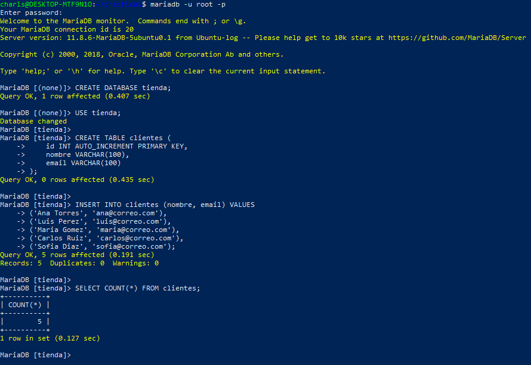

---

### Paso 2. Generación del respaldo lógico

Desde la terminal del sistema se utiliza `mariadb-dump` con la bandera `--databases` para generar un volcado lógico completo (`tienda_backup.sql`) que incluya tanto la sentencia de creación del esquema (`CREATE DATABASE`) como la estructura de la tabla y sus 5 registros. Posteriormente, se verifica la existencia y el tamaño del archivo.

**Comandos ejecutados:**

```bash
mariadb-dump -u root -p --databases tienda > tienda_backup.sql
ls -lh tienda_backup.sql
```

**Resultado obtenido:**  
Se creó satisfactoriamente el archivo `tienda_backup.sql` en la carpeta `practica1` con un tamaño válido mayor a cero bytes.

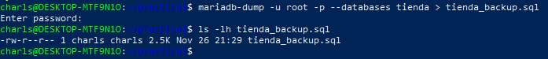

---

### Paso 3. Simulación del desastre

Para poner a prueba la efectividad del respaldo, se simula un error humano crítico eliminando por completo la base de datos `tienda` mediante la sentencia `DROP DATABASE` y comprobando con `SHOW DATABASES` que ha desaparecido del servidor.

**Comandos ejecutados:**

```bash
mariadb -u root -p
```

```sql
DROP DATABASE tienda;
SHOW DATABASES;
EXIT;
```

**Resultado obtenido:**  
La base de datos `tienda` fue eliminada del servidor y dejó de aparecer en el listado de bases de datos disponibles.

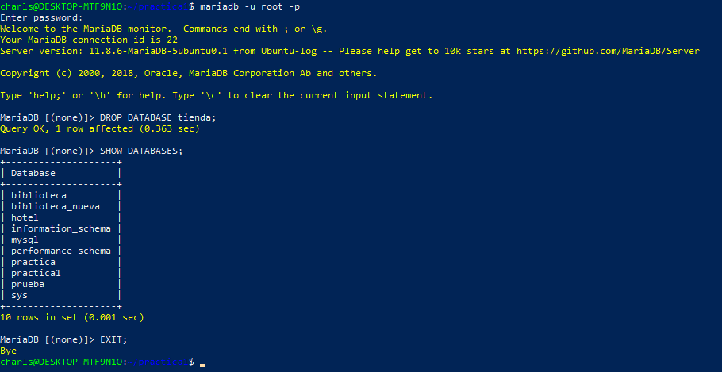

---

### Paso 4. Restauración del respaldo

Se procede a restaurar la base de datos redirigiendo el archivo `tienda_backup.sql` hacia el cliente de MariaDB. Debido a que el archivo fue generado con `--databases`, no es necesario crear previamente el esquema vacío.

**Comando ejecutado:**

```bash
mariadb -u root -p < tienda_backup.sql
```

**Resultado obtenido:**  
El comando se ejecutó sin mostrar mensajes de error, reconstruyendo la base de datos `tienda`, la tabla `clientes` y sus registros.

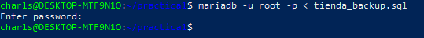

---

### Paso 5. Verificación de la recuperación

Se consulta de forma directa el contenido de la tabla `tienda.clientes` para confirmar que la información fue recuperada de manera íntegra.

**Comando ejecutado:**

```bash
mariadb -u root -p -e "SELECT * FROM tienda.clientes;"
```

**Resultado obtenido:**  
Se visualizaron nuevamente los 5 registros de clientes originales (`Ana Torres`, `Luis Perez`, `Maria Gomez`, `Carlos Ruiz` y `Sofia Diaz`), concluyendo exitosamente la **Parte A**.

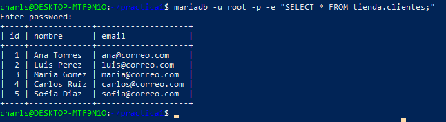

---

# PARTE B: Recuperación de datos posteriores al respaldo con el binlog (PITR)

Aunque el respaldo lógico de la Parte A permite recuperar el estado exacto al momento de la copia, cualquier transacción ocurrida después del respaldo se perdería ante un incidente. Para resolver esta limitación, se habilita el **registro binario (binlog)** y se aplica una recuperación a un punto exacto en el tiempo.

### Paso 1. Activación del registro binario (binlog)

Se edita el archivo de configuración del servidor MariaDB para habilitar `log_bin` y asignar un identificador único de servidor (`server_id = 1`) bajo la sección `[mariadbd]`. Posteriormente, se reinicia el servicio y se verifica que la variable `log_bin` aparezca activa (`ON`).

**Comandos ejecutados:**

```bash
sudo nano /etc/mysql/mariadb.conf.d/50-server.cnf
```

Líneas agregadas bajo `[mariadbd]`:

```ini
log_bin = /var/lib/mysql/mariadb-bin
server_id = 1
```

Reinicio y verificación del servicio:

```bash
sudo systemctl restart mariadb
mariadb -u root -p -e "SHOW VARIABLES LIKE 'log_bin';"
```

**Resultado obtenido:**  
El servicio se reinició correctamente y la consulta devolvió `log_bin = ON`, confirmando que MariaDB ya registra todas las modificaciones en el binlog.

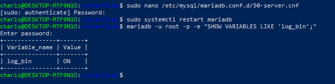

---

### Paso 2. Respaldo con registro de posición del binlog

Se genera un nuevo respaldo completo (`tienda_pitr.sql`) utilizando las opciones `--flush-logs` (para rotar el archivo de binlog e iniciar uno nuevo) y `--master-data=2` (para insertar como comentario dentro del archivo `.sql` el nombre exacto del archivo binlog y la posición de inicio). Posteriormente, se extrae esa línea mediante `grep`.

**Comandos ejecutados:**

```bash
mariadb-dump -u root -p --databases tienda --flush-logs --master-data=2 > tienda_pitr.sql
grep "CHANGE MASTER" tienda_pitr.sql
```

**Resultado obtenido:**  
Se obtuvo la coordenada exacta del registro binario a partir de la cual se registrarán los cambios posteriores al respaldo:

* **Archivo binlog (`MASTER_LOG_FILE`):** mysql-bin.000021
* **Posición inicial (`MASTER_LOG_POS`):** 385

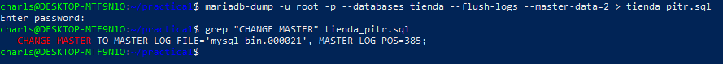

---

### Paso 3. Inserción de nuevos datos posteriores al respaldo

Se insertan dos nuevos clientes (`Pedro Nunez` y `Laura Vega`) que **no existen** dentro de `tienda_pitr.sql`. Luego se verifica que el total de registros sea `7`, se esperan 5 segundos para crear un margen temporal limpio y se consulta la fecha y hora exacta del servidor mediante `SELECT NOW()`.

**Comandos ejecutados:**

```bash
mariadb -u root -p
```

```sql
USE tienda;
INSERT INTO clientes (nombre, email) VALUES
('Pedro Nunez', 'pedro@correo.com'),
('Laura Vega', 'laura@correo.com');

SELECT COUNT(*) FROM clientes;
```

*(Después de esperar 5 segundos)*

```sql
SELECT NOW();
```

**Resultado obtenido:**  
El conteo devolvió `7` clientes y se registró la marca de tiempo exacta previa al incidente:

* **Hora registrada (`NOW()`):** 2026-11-26 21:42:24

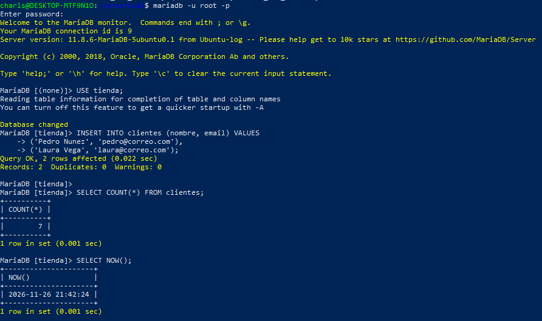

---

### Paso 4. Simulación de un error humano (`DELETE` sin `WHERE`)

Tras esperar otros 5 segundos para separar cronológicamente la inserción válida del evento destructivo, se ejecuta una sentencia `DELETE FROM clientes;` sin cláusula `WHERE`, eliminando todos los registros de la tabla.

**Comandos ejecutados:**

```sql
DELETE FROM clientes;
SELECT COUNT(*) FROM clientes;
EXIT;
```

**Resultado obtenido:**  
La consulta `SELECT COUNT(*)` devolvió `0`, confirmando el borrado accidental de toda la tabla `clientes`.

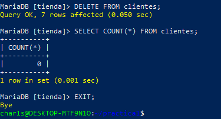

---

### Paso 5. Restauración del respaldo base

Como primer paso de la recuperación PITR, se restaura el respaldo `tienda_pitr.sql`. En este punto, la tabla `clientes` recupera únicamente los 5 registros originales, faltando aún los datos de Pedro y Laura.

**Comando ejecutado:**

```bash
mariadb -u root -p < tienda_pitr.sql
```

**Resultado obtenido:**  
La base de datos fue restaurada al punto del respaldo base sin errores.

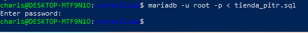

---

### Paso 6. Aplicación del binlog hasta antes del error

Utilizando la herramienta `mariadb-binlog`, se reproducen únicamente las transacciones registradas desde la posición inicial (`--start-position`) obtenida en el Paso 2 hasta la marca de tiempo (`--stop-datetime`) registrada en el Paso 3, deteniendo la ejecución antes del `DELETE` accidental y enviando la salida mediante una tubería hacia MariaDB.

**Comando ejecutado:**

```bash
sudo mariadb-binlog --start-position=385 --stop-datetime="2026-11-26 21:42:24" \
    /var/lib/mariadb/mysql-bin.000021 > recuperacion_binlog.sql

mariadb -u root -p < recuperacion_binlog.sql
```

**Resultado obtenido:**  
Las sentencias de inserción posteriores al respaldo fueron reaplicadas exitosamente sobre la base de datos `tienda`, omitiendo el borrado accidental.


---

### Paso 7. Verificación final de la recuperación PITR

Se consulta nuevamente la tabla `tienda.clientes` para corroborar que tanto los registros originales como los agregados después del respaldo fueron recuperados en su totalidad.

**Comando ejecutado:**

```bash
mariadb -u root -p -e "SELECT * FROM tienda.clientes;"
```

**Resultado obtenido:**  
La consulta devolvió los **7 clientes** completos, incluyendo a **Pedro Nunez** y **Laura Vega**, confirmando que la recuperación a un punto en el tiempo fue completamente exitosa y excluyó el `DELETE` accidental.

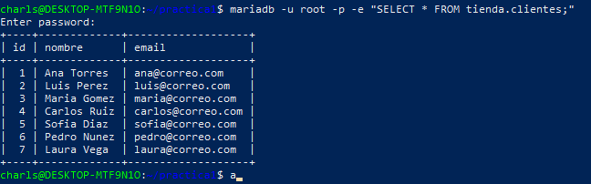

---

## Conclusiones

La ejecución de esta práctica permitió comprobar en un entorno real la diferencia entre una restauración tradicional mediante respaldos lógicos y una recuperación avanzada a un punto en el tiempo (PITR). Mientras que `mariadb-dump` ofrece una solución rápida y portable para recuperar un estado completo guardado previamente, resulta insuficiente por sí solo para evitar la pérdida de transacciones recientes (*RPO* cercano a cero).

Al activar el registro binario (`log_bin`) y combinar respaldos etiquetados con `--master-data=2` y `--flush-logs` junto con la utilidad `mariadb-binlog`, se demostró cómo reconstruir la historia exacta de cambios de una base de datos y detener la restauración segundos antes de un error humano crítico. Esto refuerza la importancia de configurar el binlog de manera preventiva y probar periódicamente los planes de recuperación en todo entorno productivo.